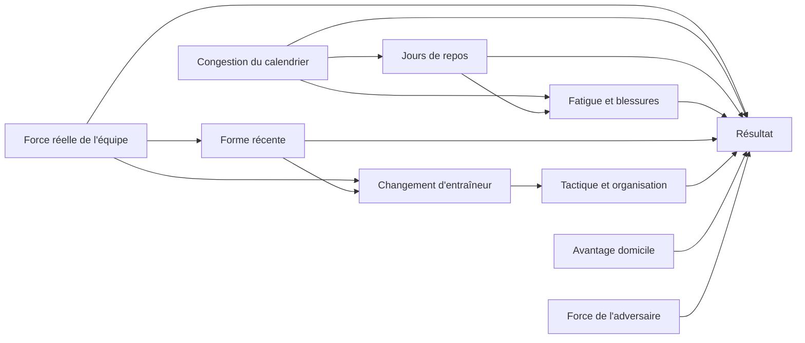
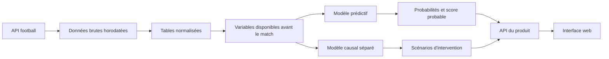

# Football Match Probability Prediction

Projet de prédiction probabiliste de matchs de football, avec une interface permettant de consulter les prochains matchs, les probabilités de résultat et les principaux facteurs associés à la prédiction.

Le projet doit distinguer deux questions :

- **Prédiction** : que va-t-il probablement se passer ? `P(Y | X)`
- **Causalité** : que se passerait-il si une variable contrôlable était modifiée ? `P(Y | do(X))`

La première version sera centrée sur la prédiction. La couche causale sera ajoutée uniquement pour les interventions dont les données et les hypothèses sont suffisamment solides.

## Résumé exécutable

Le projet commencera en deux phases :

1. **Prototype hors production** : utiliser les CSV existants pour construire le pipeline, les baselines et la validation chronologique.
2. **Version exploitable** : choisir une API, importer deux à trois saisons homogènes, reconstruire les variables et réentraîner le modèle avant de prédire de vrais matchs.

Il n'est donc pas nécessaire d'attendre l'API pour commencer à développer. En revanche, le modèle entraîné sur les CSV actuels ne sera pas considéré comme directement compatible avec les futures données tant que les définitions des variables n'auront pas été reproduites.

Compétitions candidates pour le premier test de couverture : Ligue 1, Ligue 2, Premier League, La Liga et Bundesliga. La liste définitive dépendra de la qualité et du coût des données disponibles.

## Installation du dataset

Les CSV complets ne sont pas versionnés dans Git. Ils sont regroupés dans l'archive `dataset.zip`, publiée dans la GitHub Release `dataset-v1.0.0`.

Depuis la racine du projet :

```bash
python scripts/download_dataset.py
```

Le script télécharge l'archive, contrôle son SHA-256, vérifie qu'elle contient exactement les quatre fichiers attendus, puis les extrait dans le dossier courant. Il refuse d'écraser des CSV existants sans l'option `--force`.

Le dépôt étant privé, le script utilise GitHub CLI en secours. Il faut alors avoir installé `gh` et exécuté `gh auth login`.

Les données restent ignorées par Git. Un petit échantillon versionnable pourra être ajouté ultérieurement dans `sample_data/` pour les tests automatisés.

## Objectifs finaux

### 1. Prédire le résultat d'un match

Pour chaque match à venir, le système doit produire trois probabilités :

```text
P(victoire domicile)
P(match nul)
P(victoire extérieure)
```

Leur somme doit être égale à 1.

Exemple :

```text
Angers SCO - Lille

Victoire Angers : 24 %
Match nul       : 29 %
Victoire Lille  : 47 %
```

L'objectif n'est pas seulement de choisir le résultat le plus probable. Les probabilités doivent être **calibrées** : parmi les événements annoncés à 60 %, environ 60 % doivent réellement se produire.

### 2. Estimer un score probable

Une extension du modèle pourra estimer séparément :

- le nombre de buts de l'équipe à domicile ;
- le nombre de buts de l'équipe à l'extérieur ;
- les scores les plus probables ;
- les probabilités 1/N/2 dérivées de ces distributions de buts.

Ce modèle de score pourra être combiné au modèle direct de résultat.

### 3. Construire une UX compréhensible

L'application devra proposer :

- une liste des prochains matchs ;
- les équipes, logos, compétition et heure du match ;
- les probabilités domicile, nul et extérieur ;
- le score le plus probable ;
- la forme récente des deux équipes ;
- les buts marqués et encaissés récemment ;
- le niveau relatif des équipes ;
- les jours de repos ;
- les absences et compositions lorsqu'elles sont disponibles ;
- une explication courte des facteurs associés à la prédiction ;
- le résultat réel après le match et l'historique des anciennes prédictions.

L'interface ne devra pas présenter une corrélation comme une cause.

### 4. Explorer des scénarios causaux

La couche causale répondra à des questions du type :

```text
Quel serait l'effet estimé de 7 jours de repos au lieu de 3 ?
Quel serait l'effet estimé d'un changement d'entraîneur ?
Quel serait l'effet estimé d'une composition ou d'une formation différente ?
```

Formellement :

```text
Effet du repos = P(Y | do(repos = 7)) - P(Y | do(repos = 3))
```

Cette partie sera séparée du moteur prédictif. Elle devra afficher les hypothèses, l'incertitude et les limites de l'estimation.

## Périmètre recommandé pour la V1

La première version ne cherchera pas à couvrir immédiatement les centaines de compétitions présentes dans les fichiers actuels.

Le périmètre recommandé est :

- 3 à 5 compétitions ;
- prédictions réalisées avant le coup d'envoi ;
- résultat domicile/nul/extérieur ;
- score probable en option ;
- mise à jour quotidienne des matchs ;
- nouvelle prédiction lorsque les compositions deviennent disponibles ;
- interface web simple ;
- validation chronologique du modèle.

Le score probable est un objectif du produit final, mais il ne bloque pas la livraison de la V1 probabiliste 1/N/2.

## Données déjà disponibles

### `train.csv`

Table principale d'entraînement :

- 110 938 matchs ;
- 190 colonnes ;
- période allant de décembre 2019 à mai 2021 ;
- résultat réel dans `target` ;
- dix matchs historiques pour chaque équipe ;
- buts, ratings, compétitions, entraîneurs, dates et contexte domicile/extérieur.

Cette table permet de créer un premier modèle expérimental et de comparer différentes familles de variables.

### `train_target_and_scores.csv`

Table des résultats finaux :

- même clé `id` que `train.csv` ;
- score final dans `score` ;
- résultat dans `target`.

Elle servira à entraîner le modèle de buts et à évaluer les prédictions après les matchs. `score` et `target` ne doivent jamais être utilisés comme entrées avant-match.

### `test.csv`

Table d'inférence historique :

- 72 711 matchs ;
- mêmes variables que `train.csv`, sans `target` ;
- période allant de mai à novembre 2021.

Les noms d'équipes y sont anonymisés. Cette table convient à la génération d'une soumission, mais pas directement à l'UX d'une application réelle.

Sans les labels réels du jeu de test, elle ne permet pas de calculer localement la performance finale. Une évaluation locale devra utiliser une partie récente de `train.csv` conservée comme validation chronologique.

### `sample_submission.csv`

Format de sortie attendu :

```csv
id,home,draw,away
```

Cette table ne contient aucune information prédictive.

## Données à récupérer pour les futurs matchs

Une API football sera utilisée comme source principale. Le scraping direct ne sera pas la fondation de la production, car les pages peuvent changer, imposer des protections anti-bot ou interdire certains usages.

Sources à tester :

- [football-data.org](https://www.football-data.org/documentation/api) pour un prototype léger ;
- [API-Football](https://www.api-football.com/) pour une couverture plus large ;
- [Sportmonks](https://www.sportmonks.com/football-api/) pour une solution produit plus complète.

Le choix final dépendra d'un test de couverture sur les compétitions sélectionnées.

Deux instantanés de prédiction seront conservés :

- **prédiction de référence à T−24 h**, utilisée pour l'évaluation principale ;
- **prédiction enrichie proche du coup d'envoi**, générée après la publication des compositions et évaluée séparément.

Cette règle évite de comparer des prédictions produites avec des quantités d'information différentes.

### Données indispensables

Pour chaque match :

- identifiant stable du match ;
- identifiants stables des équipes ;
- noms et logos des équipes ;
- compétition et saison ;
- date et heure en UTC ;
- équipe à domicile et équipe à l'extérieur ;
- statut du match ;
- score final ;
- entraîneur de chaque équipe ;
- terrain neutre ou domicile réel ;
- match de coupe ou de championnat.

### Données historiques des équipes

Pour reconstruire les variables du modèle :

- résultats des matchs précédents ;
- buts marqués et encaissés ;
- lieu domicile/extérieur ;
- adversaire rencontré ;
- niveau de l'adversaire ;
- compétition jouée ;
- date du match ;
- entraîneur en poste ;
- cartons et expulsions si disponibles.

### Données enrichies

À ajouter après la V1 :

- compositions officielles ;
- minutes jouées par joueur ;
- blessures et suspensions ;
- formation tactique ;
- statistiques de tirs et tirs cadrés ;
- expected goals ;
- possession et événements du match ;
- distance du déplacement ;
- météo ;
- cotes de marché enregistrées avant le match.

Les cotes peuvent constituer un benchmark très puissant, mais elles doivent être horodatées et ne jamais provenir d'une période postérieure à la prédiction.

## Variables qui seront construites

Les dix matchs précédents ne seront pas envoyés au modèle uniquement sous forme de colonnes brutes. Ils serviront à produire des variables synthétiques.

### Forme

- points moyens sur 3, 5 et 10 matchs ;
- série de victoires ou de défaites ;
- forme pondérée donnant plus de poids aux matchs récents ;
- forme à domicile pour l'équipe locale ;
- forme à l'extérieur pour l'équipe visiteuse.

### Buts

- buts marqués moyens ;
- buts encaissés moyens ;
- différence de buts ;
- régularité offensive et défensive ;
- valeurs pondérées par la force de l'adversaire.

### Niveau relatif

- différence de rating entre les équipes ;
- force moyenne des adversaires récemment rencontrés ;
- classement ou rating Elo construit uniquement avec le passé ;
- avantage domicile estimé par compétition.

### Calendrier

- jours depuis le dernier match ;
- nombre de matchs sur les 14 et 30 derniers jours ;
- durée du déplacement si disponible ;
- changement de compétition ;
- congestion du calendrier.

### Entraîneur et effectif

- changement récent d'entraîneur ;
- nombre de matchs du coach avec l'équipe ;
- stabilité de la composition ;
- titulaires absents ;
- minutes indisponibles à cause des blessures ou suspensions.

Le modèle utilisera principalement des **différences entre l'équipe à domicile et l'équipe à l'extérieur**.

## Compatibilité entre anciennes et nouvelles données

Les variables provenant d'une nouvelle API ne sont pas automatiquement compatibles avec celles du dataset actuel.

En particulier, la définition exacte de `history_rating` n'est pas documentée. Un rating provenant d'une autre source peut avoir une échelle ou une méthode de calcul différente.

Deux stratégies sont possibles :

1. réentraîner le modèle sans les variables impossibles à reproduire ;
2. récupérer plusieurs saisons depuis la nouvelle API, reconstruire toutes les variables et réentraîner le modèle sur une source homogène.

La deuxième stratégie sera privilégiée pour la version finale.

## Modèle causal envisagé

Le graphe suivant servira de première hypothèse de travail :



Ce graphe ne prouve aucune relation. Il sert à identifier :

- les traitements étudiés ;
- les facteurs de confusion ;
- les médiateurs ;
- les variables qu'il faut ou ne faut pas contrôler.

Les premières interventions étudiables seront probablement les jours de repos et le changement d'entraîneur. Les ratings, la forme et les buts passés sont surtout des états observés, pas des interventions directement manipulables.

## Pipeline de données cible



Les données brutes seront conservées afin de pouvoir reconstruire les variables et auditer une prédiction ancienne.

## Tables produit envisagées

### `teams`

Identité normalisée des équipes, noms, pays et logos.

### `matches`

Calendrier, équipes, compétition, date, statut et résultat final.

### `coaches`

Identité des entraîneurs et périodes passées dans chaque club.

### `player_availability`

Blessures, suspensions et disponibilité connue à une date donnée.

### `match_features`

Variables calculées telles qu'elles étaient disponibles au moment de la prédiction.

### `predictions`

Probabilités, score probable, version du modèle, heure de calcul et niveau d'incertitude.

### `results`

Score réel et métriques d'évaluation de la prédiction.

### `causal_estimates`

Intervention étudiée, population, effet estimé, intervalle d'incertitude et hypothèses.

## Prévention des fuites de données

Pour une prédiction générée à l'instant `t`, seules les informations publiées avant `t` pourront être utilisées.

Il faudra notamment :

- séparer date du match, date de publication et date d'ingestion ;
- conserver l'heure de chaque prédiction ;
- ne pas utiliser une composition publiée après la prédiction ;
- ne pas reconstruire le passé avec une information corrigée ultérieurement sans la dater ;
- effectuer la validation dans l'ordre chronologique ;
- calculer les historiques uniquement avec les matchs antérieurs.

## Évaluation

### Modèle prédictif

Métriques principales :

- log loss multiclasses ;
- Brier score ;
- courbes de calibration ;
- calibration par compétition ;
- performance dans le temps.

L'accuracy sera affichée, mais ne sera pas la métrique principale.

Le modèle sera comparé au minimum à :

- la distribution moyenne domicile/nul/extérieur ;
- un modèle basé uniquement sur l'avantage domicile ;
- un modèle Elo simple ;
- les probabilités implicites des bookmakers si les cotes sont disponibles légalement.

### Modèle causal

L'évaluation devra documenter :

- le traitement étudié ;
- les facteurs de confusion retenus ;
- l'hypothèse d'absence de confusion non observée ;
- la disponibilité des différents traitements dans les données ;
- les tests de robustesse ;
- l'intervalle d'incertitude ;
- les limites d'interprétation.

## Critères de réussite de la V1

La V1 sera considérée comme terminée lorsque :

- les prochains matchs de 3 à 5 compétitions sont importés automatiquement ;
- les équipes sont identifiées par des IDs stables ;
- les variables sont calculées sans information future ;
- une validation chronologique reproductible est disponible ;
- le modèle améliore la log loss du baseline ;
- les probabilités sont calibrées ou corrigées par calibration ;
- les prédictions sont enregistrées avant les matchs ;
- l'interface affiche les matchs et les trois probabilités ;
- les résultats réels mettent à jour les métriques ;
- aucune affirmation causale n'est affichée comme certaine.

## Ordre de réalisation

1. Choisir 3 à 5 compétitions.
2. Tester les APIs sur leur couverture réelle.
3. Choisir une source principale et vérifier sa licence d'utilisation.
4. Définir les tables normalisées et les identifiants.
5. Importer deux à trois saisons historiques.
6. Reproduire les variables de forme, buts, niveau et repos.
7. Créer les baselines et la validation chronologique.
8. Entraîner et calibrer le modèle 1/N/2.
9. Enregistrer automatiquement les prédictions futures.
10. Construire l'API et l'interface utilisateur.
11. Ajouter les compositions et absences.
12. Étudier séparément une première question causale.

## Décisions prises avant le développement

- Une API sera préférée au scraping pour la source principale.
- La V1 couvrira peu de compétitions mais correctement.
- Toutes les variables devront être reproductibles avec la nouvelle source.
- La validation sera chronologique, jamais aléatoire par défaut.
- Les probabilités et leur calibration seront prioritaires sur l'accuracy.
- La prédiction et l'inférence causale resteront deux modules distincts.
- Le produit conservera les données et prédictions historiques pour permettre leur audit.
